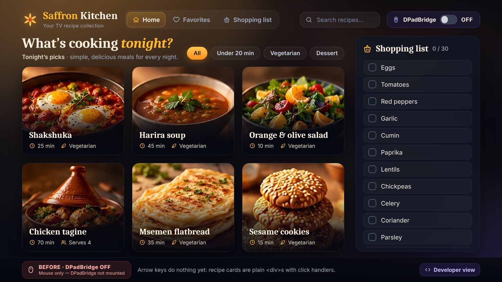
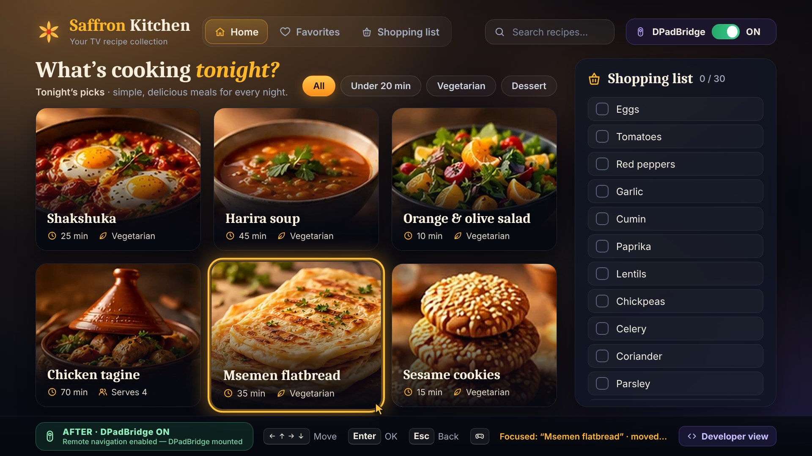
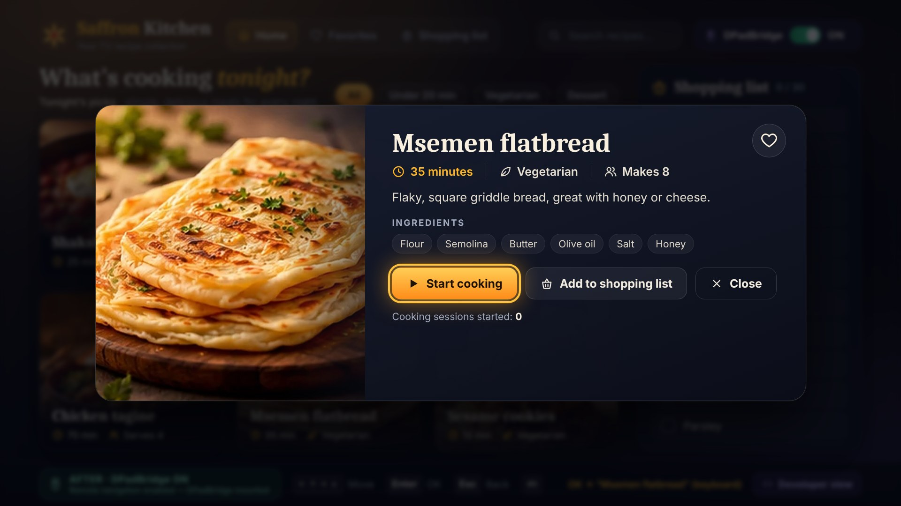
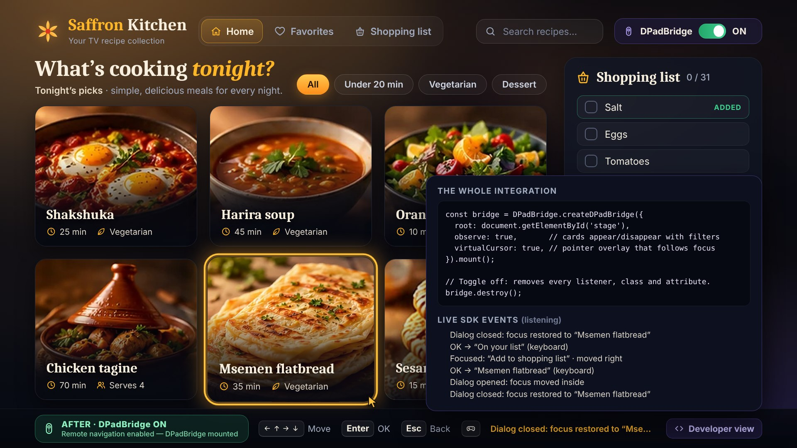
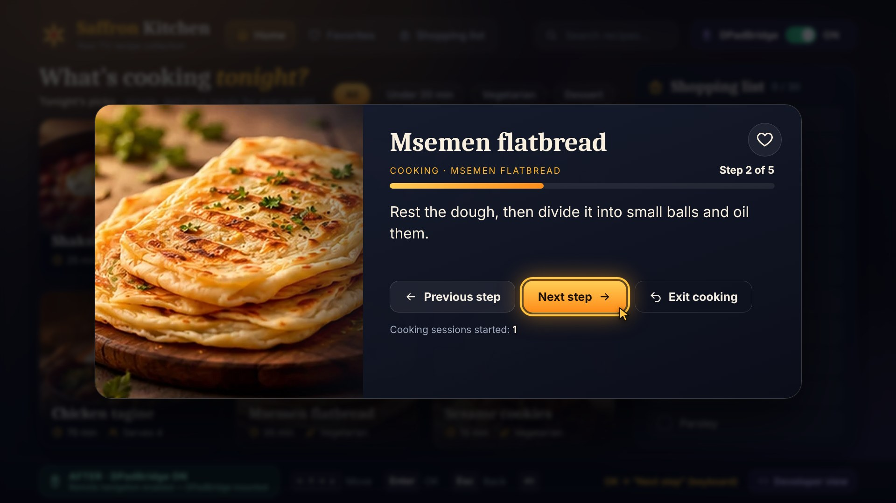
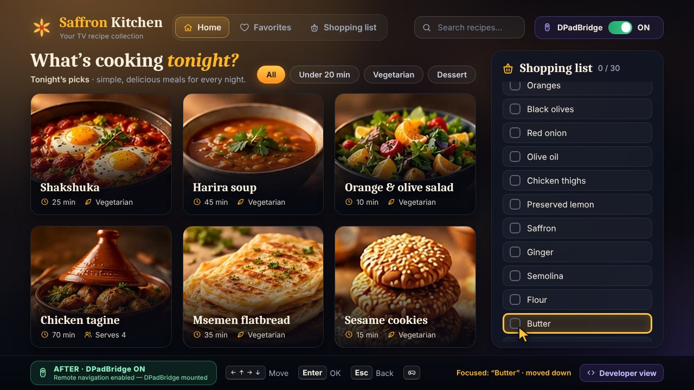

# DPadBridge SDK

**Make ordinary DOM web interfaces navigable with a TV remote and a gamepad, without rebuilding the UI.**

Many small HTML5 apps were built for a mouse: `<div onclick>` cards, menus and dialogs that a TV remote cannot reach. DPadBridge adds a predictable spatial focus model on top of the DOM you already have. It handles Up/Down/Left/Right, OK and Back, scrolls to keep the focused element visible, and contains and restores focus around modals. It is plain JavaScript with no framework, no build step and no network access, MIT licensed.

```html
<script src="dist/dpad-bridge.js"></script>
<script>
  DPadBridge.createDPadBridge({
    root: document.querySelector('#app'),
  }).mount();
</script>
```

| Before: mouse only, SDK not mounted | After: same DOM, DPadBridge mounted |
| --- | --- |
|  |  |
|  |  |





<sub>Real screenshots of the running `examples/tv-demo` at 1920×1080 and 1280×720, captured with headless Chromium by `npm run screenshots`.</sub>

---

## What it does

| Capability | How |
| --- | --- |
| **Finds navigable targets** | Buttons, links with `href`, form controls, `summary`, `[tabindex]` and anything marked `data-dpad-focusable`. Skips disabled (including inside `fieldset[disabled]` and `aria-disabled`), `hidden`, `inert`, `aria-hidden`, `display:none`, `visibility:hidden` and zero-size elements. |
| **Spatial D-pad navigation** | Scores candidates from real `getBoundingClientRect()` boxes: direction filter, edge gap, perpendicular gap, alignment, then deterministic tie-breaks. See [ARCHITECTURE](docs/ARCHITECTURE.md). |
| **No diagonal panel hopping** | `data-dpad-group` panels keep focus inside the panel while a target exists in that direction. Focus leaves a panel only to a target (or a whole panel) that lines up with it, and returns to the last-focused item when you come back. |
| **One real focus** | Exactly one element gets the `dpad-focus` class **and** real DOM focus (`element.focus()`), so screen readers, `:focus` and Tab order still work. Tab and mouse focus are adopted. |
| **OK / Enter** | Activates through the element's own `click()` (links navigate, buttons submit, checkboxes toggle, `<div onclick>` fires), exactly once. Native Enter activation is suppressed, held Enter does not repeat, and keyboard + gamepad presses within a short window are de-duplicated. |
| **Back** | `onBack` callback first. Otherwise it closes the open modal. If nothing handles it, the key is **not** prevented, so the platform's own Back (exit or history) still works. |
| **Modals** | Detects `dialog[open]`, `[aria-modal="true"]` and `[data-dpad-modal]`. Moves focus inside, keeps arrows and Tab inside, and restores focus to the opener (or to `data-dpad-restore`) on close. |
| **Focus-aware scrolling** | Reveals the focused element inside every scrollable ancestor, with a margin. Smooth scrolling, or instant under `prefers-reduced-motion`. `nearest` or `center` mode. |
| **Typing is safe** | Letters, Space, Backspace and Enter in text fields go to the field. Left/Right leave a text input only from the caret edge. Up/Down change a number input, Left/Right adjust a range. |
| **Virtual cursor** (opt-in) | `virtualCursor: true` draws an on-screen pointer that follows D-pad and gamepad focus, animates between targets, stays inside the viewport, follows scrolling and moves into open modals. It sits at the target's bottom-right edge so it doesn't cover text. When a real mouse is used it hides and the native cursor returns; the next remote or gamepad input brings it back. It is a DOM overlay: browsers do not let JavaScript move the operating system's mouse pointer. |
| **Gamepad** | Gamepad API standard mapping: D-pad or left stick moves, A = OK, B = Back. Presses are edge-detected and held directions auto-repeat. The poll loop runs only while a pad is connected, and the SDK does nothing if the API is missing. |
| **Dynamic DOM** | Call `.refresh()`, or pass `observe: true` for a batched MutationObserver that ignores the SDK's own writes. |
| **Clean teardown** | `.destroy()` removes every listener, the observer, the animation-frame loop, the injected stylesheet, the focus class and any `tabindex` it added. |

### Not in scope (honest limitations)

- **No canvas/WebGL conversion.** Only DOM elements can be focused. A game drawn on a `<canvas>` needs its own input code.
- **Your own page only.** It does not affect other apps, browser chrome or Fire TV / Android TV system UI, and it never remaps OS keys. Media and voice/microphone keys are not in the keymap and pass through untouched.
- **Virtualized lists.** Elements that are not in the DOM cannot be focused. Use the `boundary` event to load more, then `.refresh()`.
- **The OS mouse pointer is never moved.** No web API allows that. The optional virtual cursor is a page-drawn overlay that follows focus.
- **Key codes differ per platform.** Arrows/Enter/Escape, `GoBack`/`BrowserBack`, webOS `461` and Tizen `10009` are mapped by default. Override with `keymap`. Not verified on physical TV hardware (see [Testing](#testing)).
- **Textarea.** Arrows edit text. Focus leaves only from the very start (Up/Left) or the very end (Down/Right).

## Install

DPadBridge is not on the npm registry yet. Use one of:

```bash
# from GitHub
npm install github:DivProGamez/dpad-bridge-sdk
```

```js
import { createDPadBridge } from 'dpad-bridge-sdk';
```

Or copy **`dist/dpad-bridge.js`** (IIFE, exposes `window.DPadBridge`, works from `file://`) or **`dist/dpad-bridge.mjs`** (ES module) into your project. There are no runtime dependencies.

## Quick start

```html
<div id="app">
  <nav data-dpad-group> <a href="#home">Home</a> <a href="#shows">Shows</a> </nav>
  <main data-dpad-group>
    <div class="card" data-dpad-focusable onclick="play(1)">Episode 1</div>
    <div class="card" data-dpad-focusable onclick="play(2)">Episode 2</div>
  </main>
</div>

<script src="dpad-bridge.js"></script>
<script>
  const bridge = DPadBridge.createDPadBridge({
    root: document.getElementById('app'),
    observe: true,                       // auto-refresh when the DOM changes
    onBack: (ctx) => {
      if (ctx.modal) return false;       // let the SDK close the open dialog
      return myRouter.back();            // return true when you handled Back
    },
  });
  bridge.mount();
</script>
```

The only markup change in the example is `data-dpad-focusable` on the `<div>` cards, which the SDK gives `tabindex="0"` while it is mounted. Native buttons, links and inputs need no change.

## API

### `createDPadBridge(options) → bridge`

| Option | Default | Description |
| --- | --- | --- |
| `root` | `document.body` | Element, selector or document to make navigable. Modals inside it are managed. |
| `selectors` | see `DEFAULT_SELECTORS` | Replace what counts as a target. `extraSelectors` adds to it. |
| `focusClass` | `'dpad-focus'` | Class on the single focused element. |
| `initialFocus` | `null` | Element or selector to focus on mount. Otherwise `[data-dpad-autofocus]`, the already-focused element, or the first target. |
| `autoFocus` | `true` | Focus something on mount and whenever nothing is focused. |
| `observe` | `false` | MutationObserver-based automatic `refresh()`. |
| `gamepad` | `true` | Gamepad API support. `false` disables it. An object tunes `deadzone` and allows test injection. |
| `keyboard` | `true` | Keyboard / remote key handling. |
| `keymap` | `DEFAULT_KEYMAP` | `{ up, down, left, right, ok, back }` → arrays of `key` strings / `keyCode` numbers. |
| `scrollMode` | `'nearest'` | `'nearest'`, `'center'` or `false`. |
| `scrollMargin` | `24` | Pixels kept between the focused element and the scroll edge. |
| `scrollBehavior` | auto | `'smooth'`, or `'auto'` when `prefers-reduced-motion: reduce`. |
| `repeatDelay` / `repeatInterval` | `400` / `120` | Gamepad auto-repeat. The interval also throttles keyboard auto-repeat. |
| `activationGuard` | `150` | ms within which a second OK on the same element is ignored. |
| `rememberGroupFocus` | `true` | Re-entering a `data-dpad-group` returns to its last-focused item. |
| `closeModalOnBack` | `true` | Back closes the top modal when `onBack` did not handle it. |
| `modalSelector` | `dialog[open], [aria-modal="true"], [data-dpad-modal]` | What counts as an open modal. |
| `virtualCursor` | `false` | `true` (or `{ hideOnMouse, followMs }`) shows the DOM virtual cursor that follows focus. Colours: `--dpad-cursor-color`, `--dpad-cursor-outline`. |
| `injectStyles` | `true` | Inject the high-contrast focus theme (customize with `--dpad-focus-color`, `--dpad-focus-width`, `--dpad-focus-offset`, `--dpad-focus-halo`). |
| `onFocus`, `onMove`, `onActivate`, `onBoundary`, `onModalOpen`, `onModalClose` | | Event callbacks (same payloads as `on()`). |
| `onBack(ctx)` | | `ctx = { modal, focused, event, source, closeModal() }`. Return `true` if you handled it. |

### Bridge methods

| Method | Description |
| --- | --- |
| `mount()` | Attach listeners, inject styles, collect targets, focus the initial element. Returns the bridge. |
| `refresh()` | Re-scan targets and modals after DOM changes. Re-homes focus if the focused element vanished. |
| `destroy()` | Remove everything the SDK added. Idempotent. The bridge can be mounted again. |
| `focus(elOrSelector)` | Focus a target (inside the open modal, if any). Returns `true` on success. |
| `move(direction)` | Programmatic `'up' \| 'down' \| 'left' \| 'right'`. Returns `false` at a boundary. |
| `activate()` / `back()` | Programmatic OK / Back. |
| `on(event, fn)` | Subscribe to `focus`, `move`, `activate`, `back`, `boundary`, `modalopen` or `modalclose`. Returns an unsubscribe function. |
| `getFocused()`, `getTargets()`, `getModal()`, `getCursor()`, `isMounted`, `root` | Introspection. `getCursor()` returns `{ visible, x, y, target }`, or `null` when the cursor is off. |

### Markup attributes

| Attribute | Effect |
| --- | --- |
| `data-dpad-focusable` | Make a non-interactive element (e.g. `<div onclick>`) a target. `="false"` opts an element out. |
| `data-dpad-ignore` | Exclude this element and its subtree. |
| `data-dpad-group` | Panel: navigation prefers staying inside, leaves only to lined-up targets, and remembers its last item. |
| `data-dpad-up/down/left/right="#selector"` | Explicit neighbour. `="none"` blocks that direction. |
| `data-dpad-modal` | Treat a custom element as a modal while visible. |
| `data-dpad-close` | The button Back should click to close a modal. |
| `data-dpad-restore="#selector"` | Where focus goes when this modal closes. |
| `data-dpad-autofocus` | Preferred initial target (also inside modals, along with `autofocus`). |
| `data-dpad-passthrough` | Arrows inside stay native (custom widgets, sliders, maps). |

Lower-level pure helpers are exported for reuse and testing: `pickNext`, `scoreCandidate`, `nearestCandidate`, `toRect`, `collectTargets`, `isUsableTarget`, `arrowOwnership`, `normalizeKey`, `normalizeGamepad`, `createGamepadPoller` and `revealElement`. TypeScript declarations are in `types/index.d.ts`.

## Demo

```bash
npm install
npm run demo
# open http://localhost:8080/examples/tv-demo/
```

- **`examples/tv-demo/`**: "Saffron Kitchen", an original, mouse-first recipe app styled as a cinematic 16:9 TV screen. It has a menu (Home, Favorites, Shopping list), a search box, filter chips, six photo recipe cards built as `<div onclick>`, a `<dialog>` with ingredients, and a scrollable shopping list that starts with 30 items. The demo **starts with DPadBridge ON** and the virtual cursor showing, so the arrow keys work straight away. The **DPadBridge switch** in the header (also reachable by D-pad), `?dpad=off`, or the `d` key turns the SDK off for the mouse-only comparison, on the **same DOM**:
  - *Before:* only the mouse works. Arrows and Enter do nothing, and Tab never reaches the cards.
  - *After:* move with the arrows and open a recipe with Enter. Focus is contained in the dialog, and Esc/Back closes it and returns focus to the card. In the dialog, "Add to shopping list" really adds the missing ingredients and the heart button saves a favorite. **Start cooking** opens a guided cooking mode with the recipe's real steps, a progress bar, Previous / Next / Finish, and an exit at every step. It also counts sessions. You can also scroll the list, type in the search box, or filter. The status bar shows the mode and the latest SDK event. The **Developer view** drawer shows the real integration code and the last six SDK events.
  - Everything is local: CSS, an inline SVG icon set and bundled JPEG photos (see `examples/tv-demo/assets/photos/CREDITS.md`). There are no remote fonts, images or CDNs, and it also works from `file://`. `app.js` is the original app and knows nothing about the SDK. `integration.js` holds the entire integration.
- **`examples/minimal/`**: the quick start on a tiny page. Open `index.html` straight from disk; no server needed.

## Testing

```bash
npm test          # 97 unit tests (node:test + jsdom), then checks dist/ matches src/
npm run test:e2e  # 33 browser tests in headless Chromium via Playwright
```

- **Unit tests** (`test/*.test.js`) cover:
  - directional scoring on grids, rows, columns, uneven layouts, ties and overlaps
  - target exclusion rules
  - boundaries and no focus loss
  - `refresh()` and observer mode, including no self-triggered refresh loops
  - single activation and key repeat
  - Back semantics, including not trapping platform Back
  - modal containment and restoration
  - scroll reveal, on a jsdom geometry harness that honours scroll offsets
  - text-input safety
  - gamepad normalisation and the repeat poller, with mocked `Gamepad` objects
  - `destroy()` leaving zero listeners
- **Focus audit** (`test/e2e/audit.spec.js`, at 1920×1080 and 1280×720): maps every arrow-key move between controls and checks that every visible control can be reached from Home: the menu, search, the switch, the filters, all six cards, all 30 checkboxes and the Developer view. Each path is then replayed with real keystrokes from a fresh page load. The same spec covers the dialog and cooking controls, the guided cooking flow, filtering, both BEFORE and AFTER modes, and mouse use.
- **End-to-end tests** (`test/e2e/demo.spec.js`) drive the real demo in headless Chromium 141: before vs after, real-layout navigation, dialog open/contain/close/restore, one activation per Enter, list scrolling, search typing, filter-driven DOM changes, Add to shopping list, favorites, the developer view, a mocked Gamepad API driving the real poller, teardown, reduced motion, and the minimal page over `file://`.
- **Not tested:** physical Fire TV / Android TV devices and real gamepads. Gamepad support is verified only against mocked Gamepad API objects, and remote keys only as synthesized `keydown` events.

CI (`.github/workflows/ci.yml`) is configured to run both suites on every push and pull request.

## Browser support

The code targets evergreen Chromium, Firefox and Safari, plus Chromium-based TV web runtimes. The bundle is compiled to ES2019. It uses `Element.closest`, `classList`, `getBoundingClientRect`, `MutationObserver` (only with `observe: true`), `requestAnimationFrame` and `focus({ preventScroll })`. It uses these when available and falls back otherwise: `checkVisibility()`, `select.showPicker()`, `matchMedia` and the Gamepad API. Automated runs cover headless Chromium (Playwright) and jsdom only.

## Project docs

- [docs/ARCHITECTURE.md](docs/ARCHITECTURE.md): scoring, event flow, focus restoration
- [docs/CONTRIBUTING.md](docs/CONTRIBUTING.md): setup, conventions, adding a test
- [docs/HACKATHON_CONTRIBUTION.md](docs/HACKATHON_CONTRIBUTION.md): what is new and what was tested

## License

[MIT](LICENSE) © 2026 DivProGamez
